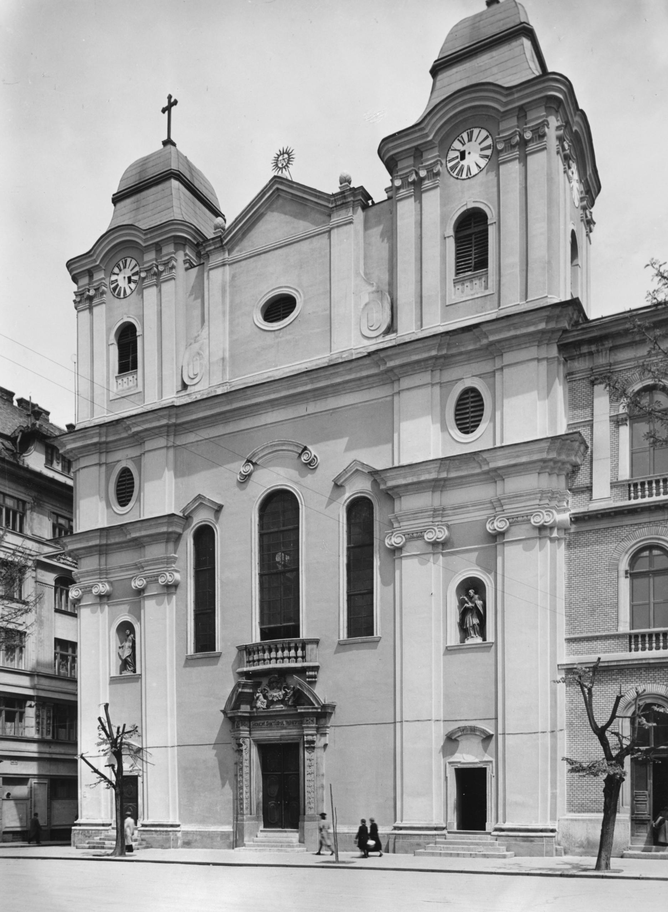
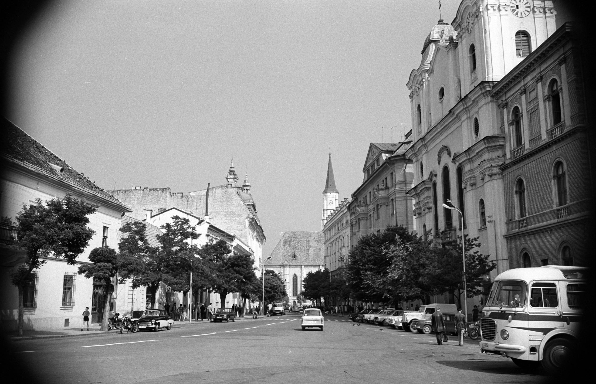
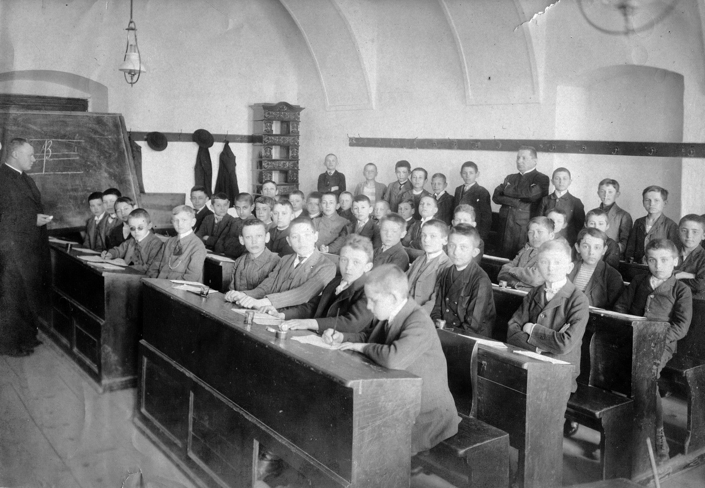
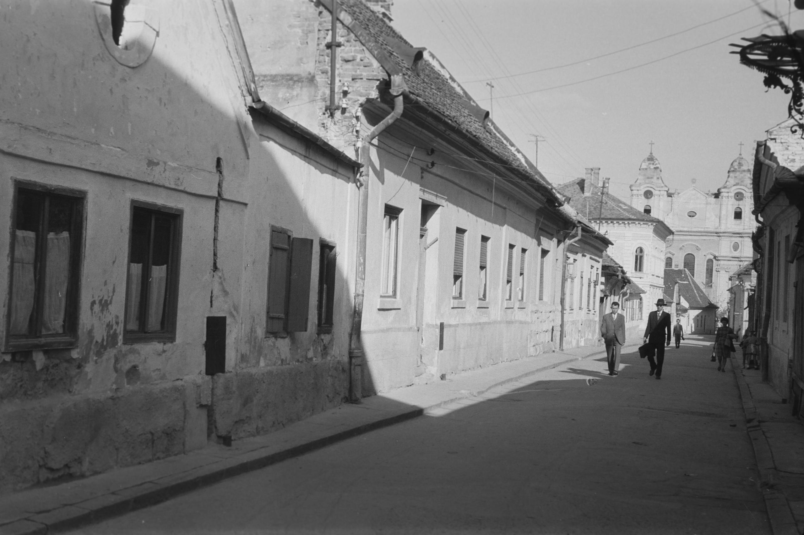
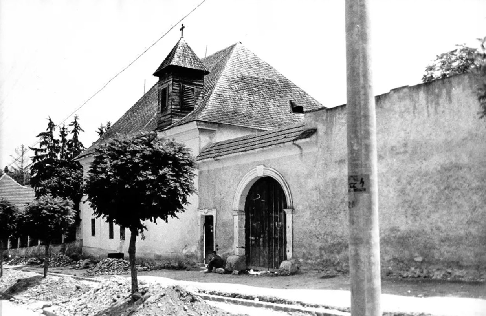
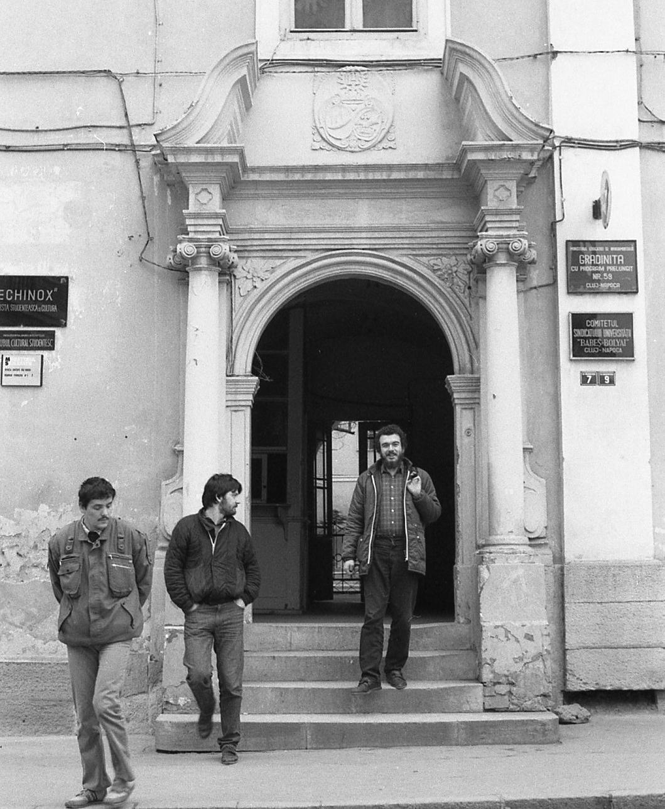
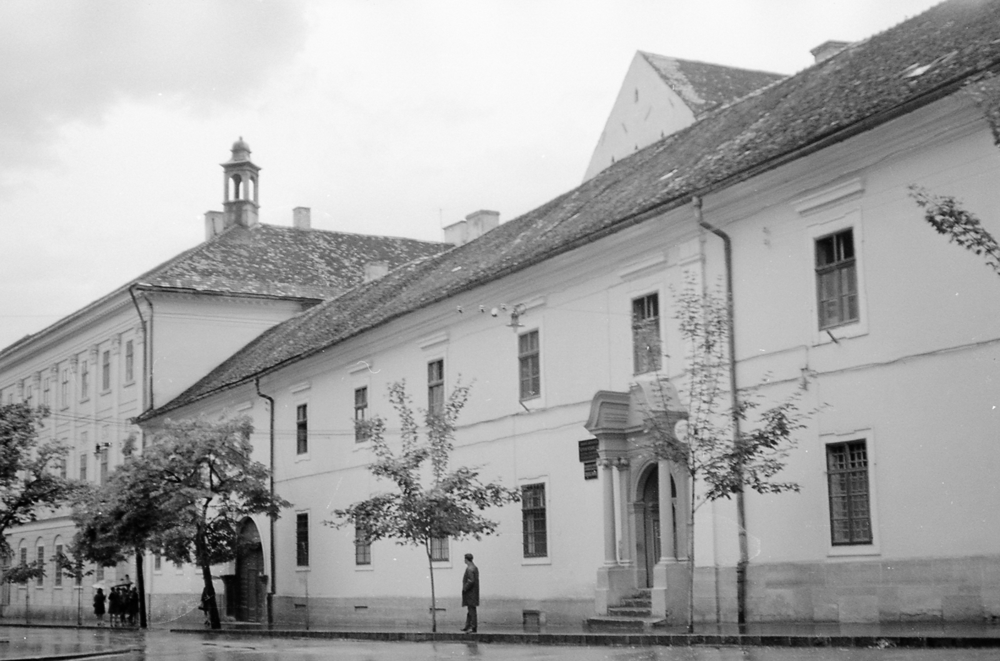
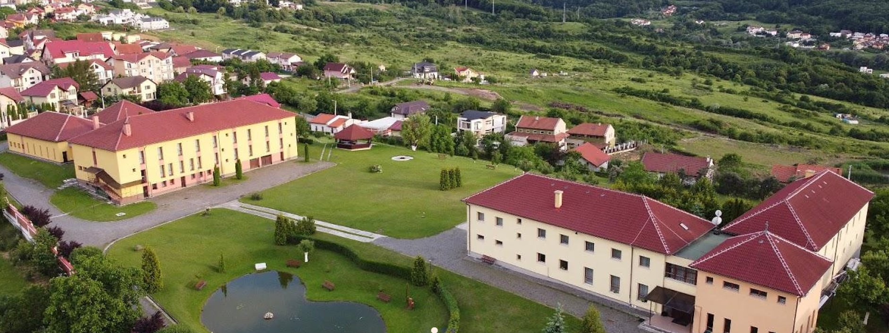

# Prezența Iezuiților în Cluj-Napoca

_Locuri, clădiri și mărturii istorice de pe strada Universității și din vechiul Cluj_
**1579 – prezent · Cluj-Napoca, România**

## Introducere

Iezuiții au ajuns la Cluj în 1579, la invitația principelui Ștefan Báthory, stabilindu-se
inițial la Mănăștur, înainte de a-și ridica, în jurul anului 1700, un ansamblu propriu
pe actuala stradă a Universității — biserică, colegiu, internat și seminar. Timp de
aproape două secole, acest nucleu a modelat viața intelectuală și religioasă a
orașului, până la dizolvarea ordinului în 1773, când patrimoniul a trecut piariștilor.

Acest ghid reunește cele opt locații identificate, însoțite de fotografii istorice de
arhivă și de o hartă schematică a complexului.

### Reperele cronologice

| An | Eveniment |
| --- | --- |
| 1579 | Iezuiții se stabilesc la Cluj-Mănăștur |
| 1693 | Folosesc temporar biserica franciscanilor |
| 1718 | Începe construcția bisericii baroce (azi Piariștilor) |
| 1773 | Dizolvarea ordinului iezuit |
| 2000+ | Revenirea iezuiților, cartierul Zorilor |

### Harta schematică a complexului de pe strada Universității

Strada Universității (fosta Belső-Torda): **1** Biserica Piariștilor — **2** Univ.
Babeș-Bolyai — **5** Convictus Nobilium — **6** Seminarul Sf. Iosif — **7** Bis.
Franciscanilor

### Cuprins

1. Biserica Piariștilor (fosta Biserică Iezuită) — 2 foto
2. Universitatea Babeș-Bolyai — clădirea centrală — 1 foto
3. Strada Búza (Strada Inocențiu Micu Klein) — 1 foto
4. Fosta mănăstire iezuită de pe Calea Mănăștur — 1 foto
5. Convictus Nobilium (azi Clădirea Echinox) — 3 foto
6. Seminarul „Sfântul Iosif” (Seminarium Bathor. Apor.)
7. Biserica Franciscanilor (folosită temporar de iezuiți)
8. Mănăstirea iezuită din cartierul Zorilor (prezent) — 1 foto

---

## 1. Biserica Piariștilor (fosta Biserică Iezuită)

_Str. Universității nr. 5, Cluj-Napoca_

Prima biserică de stil baroc din Transilvania a fost ridicată de iezuiți între 1718 și 1725,
după modelul bisericii romane Il Gesù, pe locul unde ordinul își construise deja un colegiu
și o reședință în jurul anului 1700. Construcția a fost atribuită arhitectului german Konrad
Hammer. Lăcașul a fost sfințit la 13 mai 1725 de episcopul Antalfi János, cu hramul Sfintei
Treimi. După dizolvarea ordinului iezuit în 1773, biserica, colegiul și mănăstirea au trecut
în proprietatea ordinului piarist, nume sub care este cunoscută astăzi de cei mai mulți
clujeni. Interiorul, lung de aproape 43 de metri, găzduiește basoreliefuri ale Sfintei Treimi
peste portalul principal și statui ale lui Ignațiu de Loyola și Francisc Xavier peste porțile
laterale — mărturii directe ale fondării iezuite a edificiului. Din 2022, slujbele au fost
reluate de călugării piariști, alături de preoții romano-catolici ai Parohiei Sfântul Mihail;
liturghii se oficiază în limbile română, maghiară și italiană.

**Fotografii istorice:**

_Fortepan #24209 (1940) — Fațada bisericii, descrisă explicit drept „fost templu iezuit”. Sursă: Fortepan.hu_

_Fortepan #202175 (1972) — Strada Universității, cu turla Bisericii Sf. Mihail și fațada Bisericii Piariștilor. Sursă: Fortepan.hu_

---

## 2. Universitatea Babeș-Bolyai — clădirea centrală

_Pe locul fostului Colegiu Iezuit, înființat în 1581_

Colegiul Iezuit din Cluj a fost fondat în 1581, la inițiativa principelui Ștefan Báthory, ca
instituție de învățământ superior umanist și teologic — una dintre primele de acest tip din
Transilvania. De-a lungul a aproape două secole, colegiul a funcționat alături de biserică
și de internatul propriu, formând un ansamblu educațional unitar pe actuala stradă a
Universității. Clădirea centrală a Universității Babeș-Bolyai de astăzi continuă, simbolic și
funcțional, această tradiție universitară inaugurată de iezuiți, fiind ridicată pe terenul și în
vecinătatea fostului complex colegial.

**Fotografii istorice:**

_Fortepan #29760 (1910) — Sala de clasă a Gimnaziului Piarist, cu elevi și profesor. Sursă: Fortepan.hu_

---

## 3. Strada Búza (Strada Inocențiu Micu Klein)

_Context istoric — perspectivă către ansamblul iezuit_

O fotografie din 1962 arată strada Búza, în prim-plan cu fațade modeste de case vechi
clujene; în plan secund se profilează turlele Bisericii Piariștilor, vizibile dinspre Strada
Universității. Imaginea ilustrează relația vizuală directă dintre cartierul rezidențial istoric
și complexul religios-educațional iezuit, care domina vizual centrul orașului prin cele două
turnuri ale bisericii.

**Fotografii istorice:**

_Fortepan #308559 (1962) — Strada Búza, cu turlele Bisericii Piariștilor vizibile în fundal. Sursă: Fortepan.hu_

---

## 4. Fosta mănăstire iezuită de pe Calea Mănăștur

_Calea Mănăștur nr. 9, Cluj-Napoca — monument istoric, clasa B_

Aici au sosit pentru prima dată iezuiții la Cluj, în 1579, la invitația principelui Ștefan
Báthory. Clădirea de la actualul număr 9 de pe Calea Mănăștur are o istorie proprie:
provine dintr-o casă medievală cumpărată în 1605 de Barbara Szentpáli, care a dăruit-o
iezuiților în 1626. Alungat din oraș în 1603, ordinul revenise în zona Clujului în 1615, când
a primit în posesie biserica Calvaria, aflată însă în ruină; din acest motiv, mănăstirea și
colegiul iezuit au funcționat până în 1670 chiar în clădirea donată de Szentpáli. După
1670, colegiul s-a mutat în oraș, iar clădirea de pe Calea Mănăștur a continuat să
funcționeze ca mănăstire, fiind supusă unor ample lucrări de reconstrucție și
reinaugurată la 3 noiembrie 1747 — dată marcată și astăzi pe bolțarul de la intrarea
carosabilă. Este, alături de biserica Calvaria (reconstruită la finele secolului al XIX-lea),
singura clădire supraviețuitoare din vechiul Mănăștur, deși se afla în afara zidurilor
medievale ale orașului. Astăzi, edificiul este monument istoric de clasa B și găzduiește o
parohie.

**Fotografii istorice:**

_Foto de epocă — Poarta de acces carosabil a fostei mănăstiri iezuite, Calea Mănăștur nr. 9._

---

## 5. Convictus Nobilium (azi Clădirea Echinox)

_Str. Universității nr. 7, Cluj-Napoca_

„Convictus Nobilium” a fost internatul Colegiului Iezuit, ridicat în stil baroc în jurul unei
curți interioare dreptunghiulare. Deasupra frontonului porții de intrare se află sigla iezuită
IHS, sub care a fost plasată inscripția „CON(victus) NOB(ilium)” — mărturie directă a
destinației originare a clădirii ca internat pentru tinerii nobili. Edificiul a format, împreună
cu Biserica Piariștilor și cu Monumentul Fecioarei Maria, un ansamblu arhitectural unitar
pe strada Universității. În perioada comunistă, clădirea a fost folosită de Universitatea
Babeș-Bolyai, iar intrarea de pe strada Farkas a păstrat, până în anii 1980-1990,
denumirea „Echinox” — numele revistei studențești găzduite în incintă, vizibil chiar pe
fațadă în fotografiile de epocă.

**Fotografii istorice:**

_Fortepan #56853 (1969) — Intrarea fostei mănăstiri piariste de pe Strada Farkas, folosită de UBB. Sursă: Fortepan.hu_

_Fortepan #55012 (1988) — Aceeași intrare, cu inscripția „ECHINOX” vizibilă pe fațadă. Sursă: Fortepan.hu_

A treia fotografie a acestei locații este disponibilă doar online, nu a fost inclusă ca imagine
încorporată în PDF: Wikimedia Commons — Fortepan 55012.jpg — Categoria: Babeș-Bolyai University.

---

## 6. Seminarul „Sfântul Iosif” (Seminarium Bathor. Apor.)

_Poarta seminarului, ridicată începând cu 1725_

Poarta Seminarului „Sfântul Iosif” al Colegiului Iezuit din Cluj a fost construită începând
cu anul 1725, ca parte a extinderii complexului educațional iezuit de pe strada
Universității. Inscripția de pe portal — „Seminarium Bathor. Apor. S. Josephi” — amintește
numele celor doi întemeietori și protectori ai instituției: principele Ștefan Báthory,
fondatorul Colegiului Iezuit în 1581, și episcopul Ștefan Apor, care a susținut financiar
dezvoltarea seminarului în secolul al XVIII-lea.

_(Nu există fotografie istorică inclusă pentru această locație în materialul sursă.)_

---

## 7. Biserica Franciscanilor (folosită temporar de iezuiți)

_Piața Muzeului, Cluj-Napoca_

În 1693, odată cu instaurarea dominației habsburgice asupra Transilvaniei, biserica și
mănăstirea franciscanilor din Piața Muzeului au fost retrocedate Bisericii Romano-Catolice
și puse la dispoziția iezuiților, care au înființat aici o școală proprie — o soluție temporară,
până la finalizarea propriului complex. Școala iezuită a funcționat în acest spațiu
împrumutat până în 1725, an în care ordinul și-a inaugurat propriul colegiu și propria
biserică baroce pe strada Universității, punând astfel capăt utilizării temporare a lăcașului
franciscan.

_(Nu există fotografie istorică inclusă pentru această locație în materialul sursă.)_

---

## 8. Mănăstirea iezuită din cartierul Zorilor (prezent)

_Revenirea ordinului la Cluj, anii 2000_

După aproape două secole de absență din peisajul religios clujean — de la dizolvarea
ordinului în 1773 până la reconstituirea sa modernă — iezuiții au revenit în oraș la
începutul anilor 2000. Aici au deschis o nouă mănăstire, situată în cartierul Zorilor, alături
de un centru destinat rugăciunii și exercițiilor spirituale. Astăzi, legătura istorică dintre
ordin și orașul Cluj se manifestă și prin slujbele oficiate la Biserica Piariștilor — fosta
biserică iezuită — în limbile română, maghiară și italiană, reluate începând cu 2022.

**Fotografii istorice:**

_Centrul Manresa — Vedere aeriană a complexului iezuit modern din Cluj, folosit pentru exerciții spirituale._

---

## Sinteză

Practic, nucleul istoriei iezuite clujene se concentrează pe strada Universității, unde
complexul format din biserică, colegiu, internat și seminar a modelat timp de aproape
două secole viața intelectuală și religioasă a orașului. Fotografiile de arhivă prezentate în
acest ghid — provenite din colecția publică Fortepan și de pe Wikimedia Commons, sub
licență liberă Creative Commons — pot fi consultate integral, la rezoluție maximă,
accesând linkurile indicate la fiecare locație.

**Surse fotografice:** Fortepan.hu (arhivă publică, licență CC-BY-SA 3.0) și Wikimedia Commons.
**Surse text:** Wikipedia, romkat.ro, utilitas.ro, mariaradio.ro, rejtekhely.ro.
